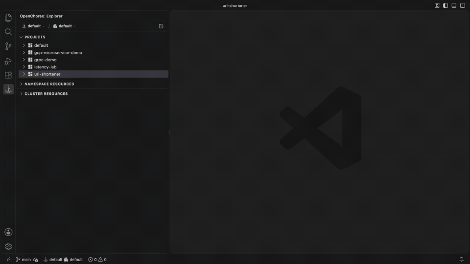
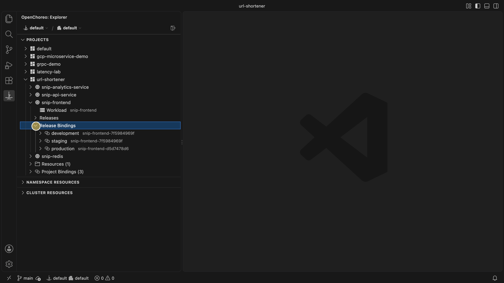
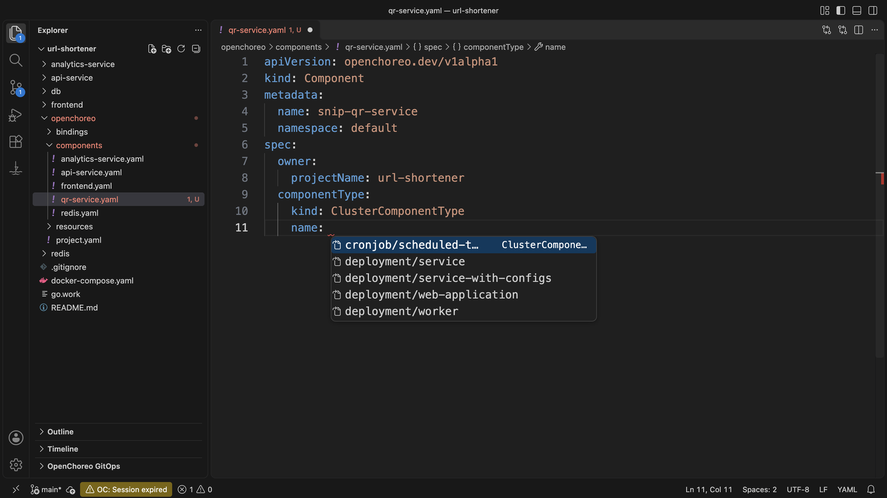
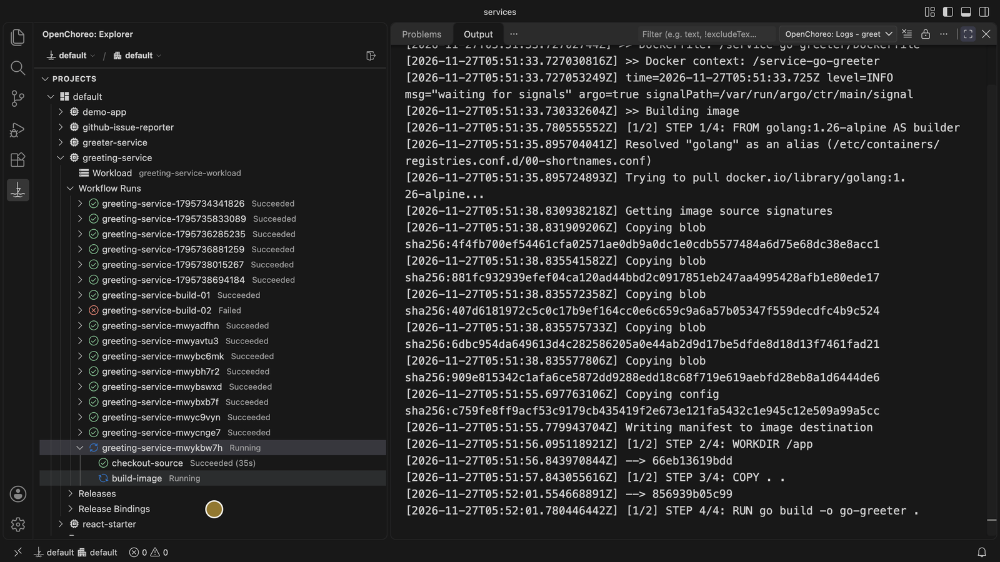
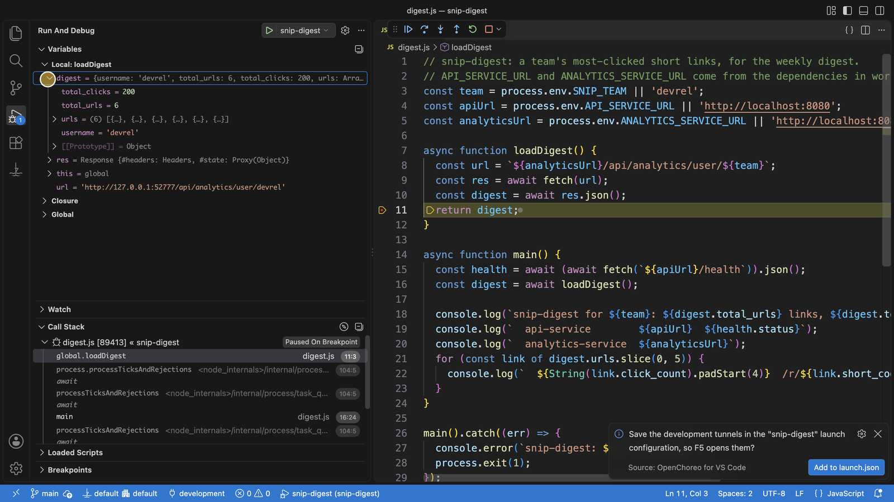
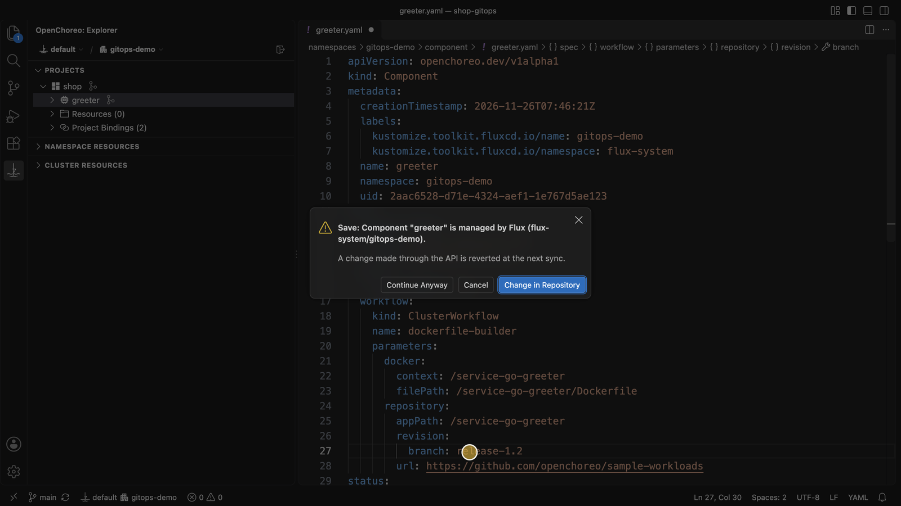
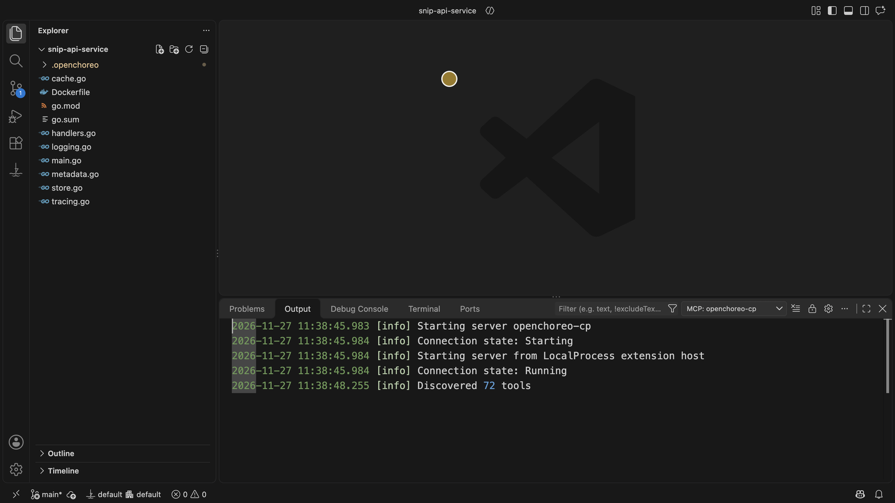

# OpenChoreo for VS Code

Your [OpenChoreo](https://openchoreo.dev) platform, inside your editor. Browse and edit live resources, build, deploy and promote, debug your code against a real environment, keep GitOps repositories and the cluster in step, write OpenChoreo YAML with cluster-aware completions, and give AI agents the OpenChoreo MCP servers and skills. Community-maintained; published as [`KavithLokuhewage.openchoreo-unofficial`](https://marketplace.visualstudio.com/items?itemName=KavithLokuhewage.openchoreo-unofficial).

<p align="center"></p>

<p align="center"><b><a href="docs/media/videos/openchoreo-for-vs-code-tour.mp4">▶ Every feature in six minutes</a></b> · <a href="docs/media/videos/openchoreo-for-vs-code-reel.mp4">The 90-second highlights</a> · <a href="docs/media/README.md">Each feature in a short video</a> · <a href="packages/extension/README.md">Full documentation</a></p>

## What it does

| | |
|---|---|
| <a href="docs/media/videos/explorer-tour.mp4"></a> | **Explore and edit.** Projects, components, environments and platform resources live from your cluster. Open any resource as YAML and save it back, create from scaffolds, scaffold a component from your source. ▶ [Tour](docs/media/videos/explorer-tour.mp4) · [Edit and save](docs/media/videos/edit-and-save.mp4) · [Create](docs/media/videos/create-resource.mp4) · [From source](docs/media/videos/scaffold-from-source.mp4) |
| <a href="docs/media/videos/smart-completions.mp4"></a> | **Write OpenChoreo YAML.** Completions from the CRD schemas and from your live cluster (component types, traits, their parameters), CEL in templates, validation as you type, hover docs and outline. ▶ [Completions](docs/media/videos/smart-completions.mp4) · [Validation](docs/media/videos/live-validation.mp4) · [CEL](docs/media/videos/cel-completions.mp4) |
| <a href="docs/media/videos/build-logs.mp4"></a> | **Build and deploy.** Trigger builds and watch each step and its logs, generate releases, deploy, promote along the pipeline, compare and roll back, and see the Kubernetes resources and pod logs behind every environment. ▶ [Build](docs/media/videos/build-logs.mp4) · [Promote](docs/media/videos/promote.mp4) · [What's running](docs/media/videos/deployed-resources.mp4) · [Compare](docs/media/videos/compare-releases.mp4) |
| <a href="docs/media/videos/debug-against-env.mp4"></a> | **Inner loop.** The status bar knows which component the open repository builds: build this commit, follow the build after a push. Debug or run your code locally against a real environment's dependencies, open a shell in a pod, read runtime logs. ▶ [Debug](docs/media/videos/debug-against-env.mp4) · [Linked component](docs/media/videos/linked-component.mp4) · [Build after a push](docs/media/videos/follow-after-push.mp4) · [Runtime logs](docs/media/videos/runtime-logs.mp4) |
| <a href="docs/media/videos/gitops-guard.mp4"></a> | **GitOps.** Flux- and Argo-managed resources are badged, and saving one offers to change the repository instead. Compare repository files with the cluster, see drift both ways, generate releases and promotions in Git and open a pull request. ▶ [Save guard](docs/media/videos/gitops-guard.mp4) · [Sync view](docs/media/videos/gitops-sync-view.mp4) · [Promote with a PR](docs/media/videos/gitops-promote.mp4) |
| <a href="docs/media/videos/mcp-servers.mp4"></a> | **AI and MCP.** The OpenChoreo MCP servers register from your occ login, and the official OpenChoreo skills and agents ship with the extension. Hand resources, failed builds and validation problems to chat, or use the same servers from Claude Code. ▶ [MCP servers](docs/media/videos/mcp-servers.mp4) · [Skills and agents](docs/media/videos/ai-customizations.mp4) · [Troubleshoot](docs/media/videos/troubleshoot-build.mp4) |

## Packages

| Package | Description |
|---|---|
| [`packages/extension`](packages/extension/) | Main VSCode extension — webview sidebar, resource editing, commands |
| [`packages/language-server`](packages/language-server/) | Language server — completions, validation, hover, symbols |
| [`packages/webview-ui`](packages/webview-ui/) | Preact-based sidebar webview — unified tree explorer with custom icons |
| [`schemas`](schemas/) | JSON Schema files for OpenChoreo CRD types |

See the [extension README](packages/extension/README.md) for full feature documentation.

## Development

```bash
# Install dependencies
pnpm install

# Build all packages
pnpm build

# Watch mode (extension)
cd packages/extension && pnpm dev

# Run tests
pnpm test

# End-to-end tests in a real VS Code (after pnpm build; Linux CI wraps this in xvfb-run)
cd packages/extension && pnpm test:e2e

# Demo footage: an MP4 per scene plus 2x screenshots in packages/extension/demo-output/
cd packages/extension && pnpm demo:capture

# Type check
cd packages/extension && pnpm lint
cd packages/language-server && pnpm lint

# Package VSIX
cd packages/extension && pnpm package
```

### Demo footage

Every user-visible feature has a scene that drives a real desktop VS Code through it with Playwright, with the packaged extension against a live OpenChoreo cluster. The scenes double as UI tests: a scene that fails stops with a `failure` screenshot.

- Scenes live in `packages/extension/src/test/demo/scenes/<area>/` (explore, language, delivery, innerloop, gitops, ai), each area's `index.ts` lists them. A scene is `{ name, title, requires?, setup?, run, teardown? }`: `setup` and `teardown` run off camera; `run` is recorded and calls `demo.mark('key', locator)` at its key moment. Reset cluster state through `src/test/demo/cluster.ts` (the OpenChoreo API with the occ login), never kubectl, so scenes run on any machine.
- `pnpm demo:capture` (in `packages/extension`) records: one MP4 and a marks JSON per scene, 2x stills, an `index.md`. `DEMO_VSIX=<file>` records the packaged build; `DEMO_SCENES`, `DEMO_WITH` (`cluster`, `gitops-workspace`, `copilot`), `DEMO_WORKSPACE`, `OCC_CONFIG`, `DEMO_SETTINGS` and the rest are described in `scripts/capture-demo.mjs`. Several captures can run side by side; it runs headless on Linux and on screen on macOS.
- [`demo/`](demo/README.md) turns the recordings into the feature shorts, highlight reel, GIFs and stills in [`docs/media/`](docs/media/README.md): `make seed-workspaces record collect render check publish`. It also holds the demo data for the cluster (`demo/seed/`) and the storyboard with each scene's hook and caption. Made with the [product-demo skill](https://github.com/kaviththiranga/product-demo-skill); the video templates use [Remotion](https://www.remotion.dev/license), free for individuals and companies of up to three people.

### Agent skills

`packages/extension/skills/` is not in git: `scripts/sync-skills.mjs` mirrors [openchoreo/skills](https://github.com/openchoreo/skills) there on every build, at the commit pinned by `openchoreoSkills.ref` in `packages/extension/package.json`. The build fails if upstream adds or removes a skill without a matching `contributes.chatSkills` entry. The weekly *Update OpenChoreo skills* workflow pins the latest upstream commit and opens a pull request; to do it by hand, run `node scripts/sync-skills.mjs --ref <sha>` in `packages/extension`.

### Regenerating CRD schemas

`schemas/*.json` are generated from the OpenChoreo CRDs at a release tag; resource
references are kept in `schemas/refs.json` and re-applied on every run:

```bash
cd packages/extension
node scripts/generate-schemas.mjs --openchoreo <path-to-openchoreo-checkout> --ref v1.3.3
```

### Running in Development

1. Open this repo in VSCode
2. Press F5 to launch the Extension Development Host
3. The extension activates automatically in the new window

## License

Apache-2.0

## Releasing

1. Bump `version` in `packages/extension/package.json` and add a `## <version> — <date>` section to `packages/extension/CHANGELOG.md`.
2. Push to `main`, then push a matching tag: `git tag v<version> && git push origin v<version>`.
3. The **Release** workflow builds, runs unit and end-to-end tests, creates the GitHub release with the `.vsix` and the changelog section as notes, and publishes to the VS Code Marketplace and, when the `OVSX_PAT` secret is set, to Open VSX.

The Marketplace uses Trusted Publishing, so no token is stored: the `KavithLokuhewage` publisher has a policy (on <https://marketplace.visualstudio.com/manage>, **Trusted Publishing**) for this repository and `release.yml` with no environment. Renaming the workflow file or the repository needs a new policy. `vsce publish --oidc` needs `@vscode/vsce` 4.

One-time Open VSX setup (Cursor, Windsurf, VSCodium and other VS Code forks install from there): sign in at <https://open-vsx.org> with GitHub, link an Eclipse account and sign the publisher agreement, create an access token, claim the namespace with `npx ovsx@1.3.0 create-namespace KavithLokuhewage -p <token>`, then save the token with `gh secret set OVSX_PAT`.

## Language servers

The extension runs one of two language servers:

- **`occ lsp --stdio`** from the installed occ, when it has the `lsp` command. It adds Go to Definition across local and cluster resources (with underlines on resolvable references), CEL suggestions, reference suggestions and pre/post-render validation. No occ is bundled.
- **The bundled TypeScript server** (`packages/language-server`) otherwise: schema validation, completions, hover and outline. Released occ versions do not have `occ lsp` yet, so this is what most users get today.

`openchoreo.languageServer` picks the server: `auto` (default) probes `occ lsp --help` and falls back to the bundled server; `occ` always uses occ lsp and shows an error when it is missing; `bundled` never probes. **OpenChoreo: Restart Language Server** re-runs the choice, for example after pointing `openchoreo.cliPath` at a new occ build. **Output → OpenChoreo** logs why the bundled server was chosen.

Notes on the occ lsp client:

- Cluster names and schemas are sent only after initialization and cleared on logout; late results from an old context or client are dropped.
- The chat YAML validation tool opens temporary LSP documents and reads their diagnostics. With the bundled server it calls `openchoreo/validate`.
- The Go server rejects the standard LSP shutdown, so the extension waits for the child process to exit before starting another one.
- For remote VS Code sessions, install and log in to `occ` on the remote host. occ reads its default `~/.openchoreo/config`.

### Verification

`pnpm test` and `pnpm test:e2e` (in `packages/extension`) check the bundled server; set `OPENCHOREO_E2E_LANGUAGE_SERVER=auto` or `occ` to run the suite against your occ. `pnpm test:definitions` checks Go to Definition with occ lsp in an isolated VS Code; set `OPENCHOREO_OCC_BINARY` to an occ that has `lsp`. If navigation fails, enable `openchoreo.definitionDebug` and restart the language server to log the executable, request positions and returned locations.
